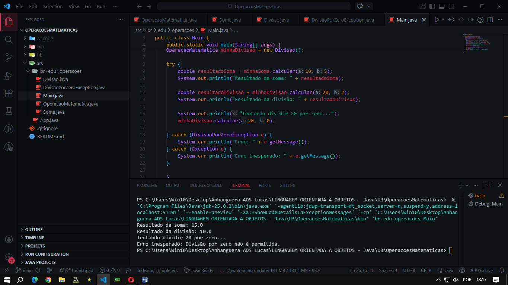

#  Sistema de Operações Matemáticas

Uma aplicação de consola desenvolvida em Java para consolidar os fundamentos de **Programação Orientada a Objetos (POO)** e **Tratamento de Exceções**. 

O projeto estrutura operações matemáticas utilizando herança e abstração, implementando regras de negócio rigorosas para prevenir falhas críticas durante a execução (como a divisão por zero).

## 🎯 Objetivo do Projeto
Este projeto foi construído para aplicar na prática conceitos estruturais exigidos no desenvolvimento de software robusto, focando em:
- Criação de contratos de código através de classes abstratas.
- Prevenção de interrupções abruptas do sistema (crashes) através da captura e tratamento de erros.
- Aplicação de polimorfismo para tornar o código extensível e limpo.

## 💻 Tecnologias e Conceitos Aplicados
- **Java (Core):** Linguagem principal do desenvolvimento.
- **Abstração e Herança:** Criação da classe abstrata `OperacaoMatematica`, servindo de base estrutural (contrato) para as classes filhas `Soma` e `Divisao`.
- **Polimorfismo:** Implementação do método `.calcular()`, onde cada classe instanciada responde de forma independente e específica ao mesmo comando.
- **Tratamento de Exceções:** Uso de blocos `try-catch` e criação da exceção personalizada `DivisaoPorZeroException` (`extends Exception`) para gerir cenários inválidos e devolver mensagens claras ao utilizador.

## 🚀 Como Funciona
A lógica central é executada na classe `Main`. O sistema instancia as diferentes operações matemáticas e invoca o método de cálculo. Para validar a resiliência do código, é forçada uma divisão por zero, o que ativa a rede de proteção do `try-catch` e exibe o erro sem quebrar a aplicação.

### Demonstração de Uso
Abaixo está a saída gerada no terminal após a execução dos cálculos e da captura da exceção:

## 📂 Estrutura do Código
Para analisar o código fonte e as decisões de arquitetura, acede aos ficheiros abaixo:
- [Contrato Abstrato (OperacaoMatematica.java)](https://github.com/lukkyzdev/OperacoesMatematicas/blob/main/src/br/edu/operacoes/OperacaoMatematica.java)
- [Regra de Soma (Soma.java)](https://github.com/lukkyzdev/OperacoesMatematicas/blob/main/src/br/edu/operacoes/Soma.java)
- [Regra de Divisão (Divisao.java)](https://github.com/lukkyzdev/OperacoesMatematicas/blob/main/src/br/edu/operacoes/Divisao.java)
- [Tratamento de Erro (DivisaoPorZeroException.java)](https://github.com/lukkyzdev/OperacoesMatematicas/blob/main/src/br/edu/operacoes/DivisaoPorZeroException.java)
- [Execução e Try-Catch (Main.java)](https://github.com/lukkyzdev/OperacoesMatematicas/blob/main/src/br/edu/operacoes/Main.java)

---
*Desenvolvido por Lucas Fontes como parte da evolução contínua em Análise e Desenvolvimento de Sistemas.*
